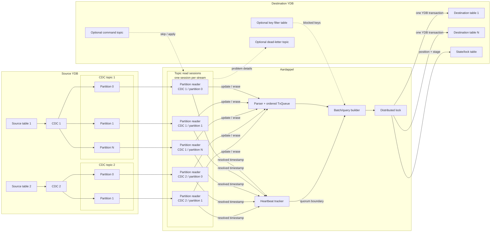
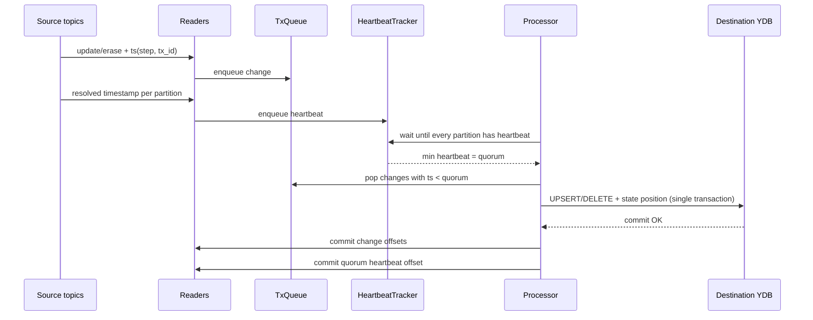
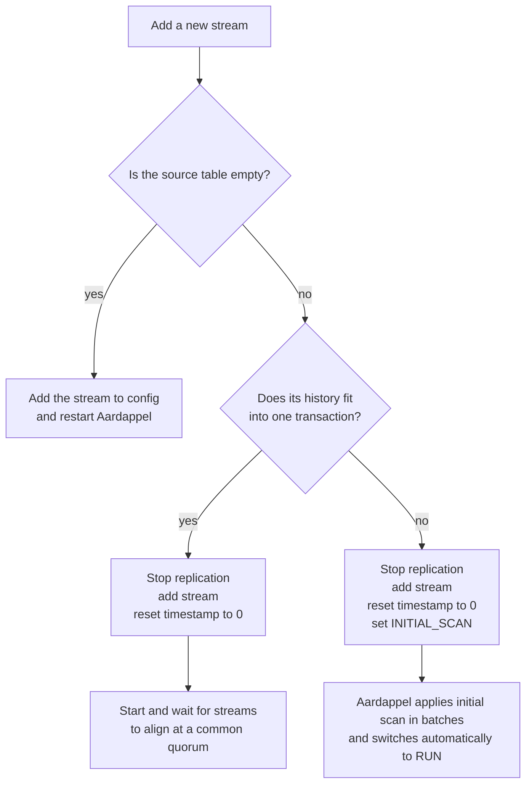
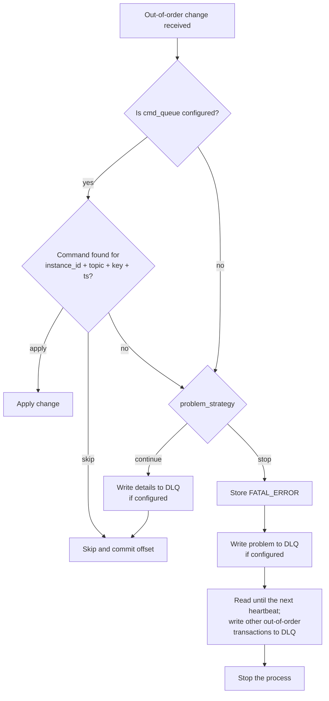
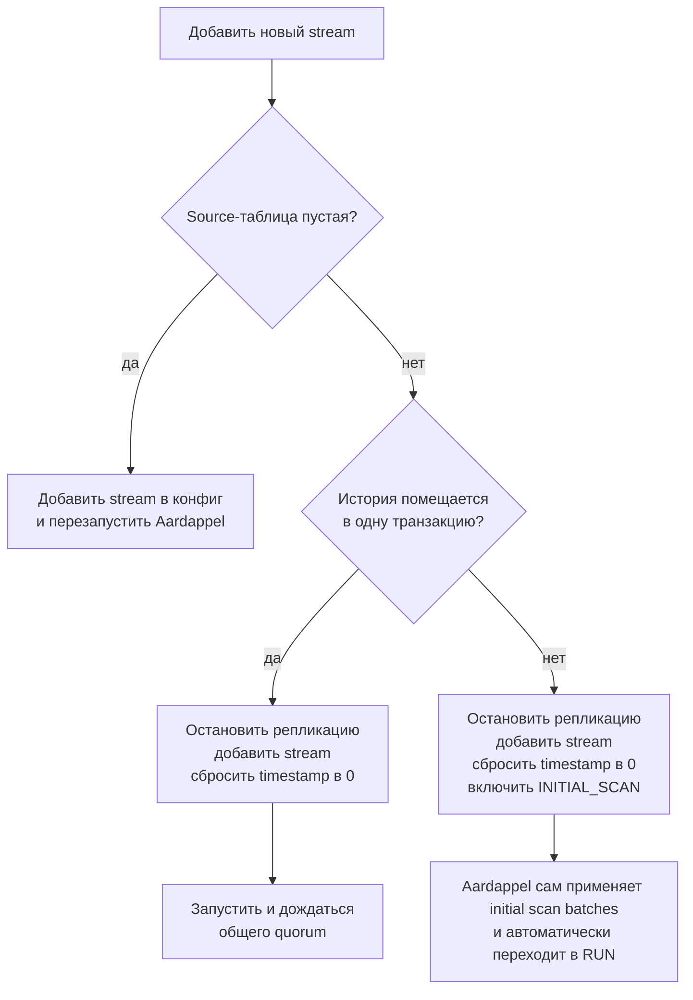
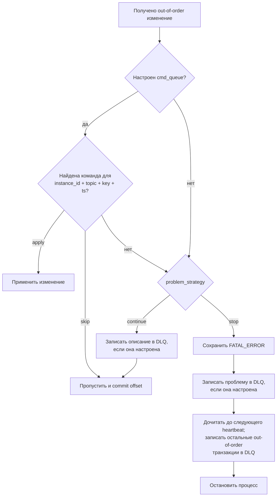

# Aardappel

[English](#aardappel) · [Русский](#aardappel-русский)

Aardappel is an asynchronous CDC replication service for YDB databases. It reads
changefeed topics from a source database, restores the global order of changes by
virtual timestamp, and atomically applies a consistent set of changes to tables in
the destination database.

Its main property is that changes from all configured streams that have reached a
common heartbeat boundary are written to the destination tables together with the
new replication position in a single YDB transaction. Topic message offsets are
committed only after that transaction has committed successfully.

## Contents

- [Architecture](#architecture)
- [Replication algorithm](#replication-algorithm)
- [Startup and recovery](#startup-and-recovery)
- [Preparing YDB](#preparing-ydb)
- [Configuration](#configuration)
- [Adding a new stream](#adding-a-new-stream)
- [Authentication](#authentication)
- [Problem message handling](#problem-message-handling)
- [Key filtering](#key-filtering)
- [Monitoring](#monitoring)
- [Build and run](#build-and-run)
- [Limitations and operational notes](#limitations-and-operational-notes)

## Architecture



A CDC changefeed is represented by a YDB topic and may contain multiple
partitions. Each `streams` entry creates one topic read session, while the YDB SDK
assigns reading of individual partitions inside that session. Therefore, every
partition has its own logical **partition reader** in the diagram. The replication
algorithm treats it as an elementary stream identified by
`(stream_id, partition_id)`.

Main components:

- `reader` creates a topic read session for every `streams` entry; messages from
  every assigned partition are handled as a separate stream, parsed from CDC JSON,
  and sent to `Processor`;
- `TxQueue` merges changes from all tables and orders them by `(step, tx_id)`;
- `HeartBeatTracker` stores the latest resolved timestamp for every partition of
  every stream;
- `Processor` selects a consistent batch, builds YQL for every destination table,
  and manages the replication position;
- `DstTable` reads the destination table schema and converts CDC values to its YDB
  types;
- `Locker` prevents two processes using the same destination state table and
  `instance_id` from writing the replica concurrently.

## Replication algorithm

### Position and heartbeat quorum

CDC messages must contain virtual timestamps. A message position is the
lexicographically ordered pair:

```text
(step_a, tx_id_a) < (step_b, tx_id_b) when
step_a < step_b or (step_a == step_b and tx_id_a < tx_id_b)
```

A resolved timestamp arrives independently from the partition reader of each
partition. One CDC may have several partitions, and every partition independently
participates in calculating the common boundary. A quorum is ready only when a
heartbeat has been received from **every partition of every configured CDC
stream**. The safe boundary is the minimum of those heartbeats:

```text
quorum = min(last_resolved[stream, partition])
```

Every change whose position is strictly lower than the quorum could already have
arrived from every partition and can be applied in global order. A change equal to
the quorum is included in a later batch.



### Query construction

For one quorum, changes are distributed by `TableId`, which is the current index
of the entry in `streams`. Within each table:

- multiple updates to one key are merged into the final set of columns;
- the last operation for a key determines the final `UPSERT` or `DELETE`;
- UPSERT groups with the same column set are combined through `AS_TABLE`;
- parameter types are obtained from the actual destination table schema.

YQL for all destination tables and the replication position UPSERT into
`state_table` run in one transaction. This preserves atomicity between the tables
and the checkpoint.

### Committing messages

The operation order is essential:

1. Apply changes and update the checkpoint in destination YDB.
2. Successfully commit the YDB transaction.
3. Commit the offsets of CDC change messages.
4. Commit the offset of the quorum heartbeat.

If the process exits between steps 2 and 3, messages may be read again. On restart,
they are discarded using the stored position. Destination writes are therefore
idempotent at the checkpoint and final UPSERT/DELETE level, while topic delivery
is effectively at-least-once.

## Startup and recovery

### State table

The table is created automatically in destination YDB:

```sql
CREATE TABLE IF NOT EXISTS <state_table> (
    id Utf8,
    step_id Uint64,
    tx_id Uint64,
    state Utf8,
    stage Utf8,
    last_msg Utf8,
    lock_owner Utf8,
    lock_deadline Timestamp,
    PRIMARY KEY (id)
);
```

One row belongs to one `instance_id` and stores:

- checkpoint: `step_id`, `tx_id`;
- state: `OK` or `FATAL_ERROR`;
- stage: `INITIAL_SCAN` or `RUN`;
- the last fatal error;
- distributed lock owner and deadline.

On the first launch, a row is created with position `(0, 0)`, state `OK`, and
stage `INITIAL_SCAN`.

### INITIAL_SCAN

The initial stage establishes a stable common boundary for all streams:

1. Read events and write batches of up to 1000 messages while collecting the
   first complete heartbeat set.
2. Remember the maximum heartbeat in that set.
3. Continue reading and writing transactions at or below that maximum until the
   quorum advances strictly beyond it. Transactions above the maximum remain
   buffered during this wait.
4. Drain all transactions strictly before the synchronized quorum, including the
   remaining partial batch.
5. Save the synchronized position and change the stage to `RUN` in a separate
   transaction containing no data changes.

### RUN

In normal operation, each iteration waits for a quorum, selects all changes
strictly before it, atomically applies them, and stores the quorum as the new
checkpoint.

### Restart

At startup, `Processor` loads the row for its `instance_id`. Messages and
heartbeats older than the stored position are immediately committed without being
applied. If the stored state is not `OK`, automatic continuation is refused: fix
the cause and recover the state deliberately first.

### Feed ownership and multiple pods

A **feed** is a logical replication unit: its streams share one heartbeat quorum,
checkpoint, and destination transaction. A **pod/process** is a worker that
acquires ownership of an available feed from the configured `feeds` list.
`instance_id` identifies persistent replication state and locking; it defaults to
the feed's `id` and must remain stable across pod replacements.

Multiple pods use the same configuration to run different feeds concurrently.
Each worker checks feeds in randomized order and runs at most one feed.
Ownership is exclusive per feed: before opening CDC read sessions, a worker
acquires the lock identified by the destination database, `state_table`, and
effective `instance_id`. Lock TTL is
`2 × max_expected_heartbeat_interval`. Only the lock owner reads and applies that
feed. Scaling the pod count allows more feeds to run concurrently; a single feed's
streams remain together under one owner, preserving their common quorum and
atomic destination writes. Independent feeds have separate checkpoints and
transactions.

Workers without an available feed keep waiting until shutdown and may acquire a
feed after its owner releases the lock or the lock expires. Set the top-level
`wait_for_feed: false` to exit after approximately 50 seconds without acquiring
ownership of any feed.

Workers eligible to own the same feed must use the same destination state table,
`instance_id`, and feed configuration, including consumers. Independent feeds
sharing a destination state table need different `instance_id` values and separate
consumers when reading the same source topics.

## Preparing YDB

### Source

Every source table needs a JSON `UPDATES` changefeed with virtual and resolved
timestamps, plus a consumer:

```bash
YDB_EXEC="ydb -e <DATABASE_ENDPOINT> -d <DATABASE_NAME>"

${YDB_EXEC} 'ALTER TABLE `<TABLE_NAME>` ADD CHANGEFEED `<CDC_NAME>` WITH (
  FORMAT = "JSON",
  MODE = "UPDATES",
  VIRTUAL_TIMESTAMPS = TRUE,
  RESOLVED_TIMESTAMPS = Interval("PT1S"),
  INITIAL_SCAN = TRUE
);'

${YDB_EXEC} 'ALTER TOPIC `<TABLE_NAME>/<CDC_NAME>` ADD CONSUMER `<CONSUMER_NAME>`;'
```

Enable `INITIAL_SCAN = TRUE` when the source table already contains data. The
changefeed then exports existing rows first and continues with new changes. It may
be omitted for a table guaranteed to be empty. Resolved timestamps may temporarily
stop during the initial scan, so Aardappel starts forming a heartbeat quorum after
the scan completes.

Every `streams` entry must reference such a topic and consumer. See the
[YDB initial scan documentation](https://ydb.tech/docs/en/yql/reference/syntax/alter_table/changefeed).

### Destination

Destination tables must be created in advance. For every source/destination pair:

- primary key column order and types must be compatible;
- CDC columns must exist in destination and have compatible types;
- the service account needs schema-read and data-write permissions;
- `state_table` must not conflict with an application table.

Aardappel does not require the complete source and destination schemas to be
identical. The practical requirement is that every source CDC message can be
applied to the corresponding destination table: all message columns must exist
and convert to destination types, and the key must match the destination primary
key.

Change schemas before dependent CDC messages appear. For example, add a compatible
column to destination first, then to source, and only then begin writing that
column in source. Otherwise Aardappel may receive a column unknown to its
destination schema and stop replication.

Each destination schema is read once at startup and cached in memory. Restart
Aardappel after a destination schema change, before dependent source messages are
produced. On restart, it runs `DescribeTable` again and refreshes its local schema.

## Configuration

The file is supplied through `-config`; the default is `config.yaml` in the current
directory. See the full example in
[`cmd/aardappel/config.yaml`](cmd/aardappel/config.yaml).

The first line must be `version: 2` to select the cluster/feed configuration format.

Configuration is read once at startup. There is no automatic reload: changing
connection strings, authentication, streams, queues, monitoring, or any other
setting requires an application restart.

```yaml
version: 2
clusters:
  - id: source
    connection_string: "grpcs://source.example.net:2135/Root/source"
    client_balancer: true
    oauth2_file: "/run/secrets/source-oauth.json"
    # static_token: "..."
    # oauth2_endpoint: "https://sts.example.net/oauth2/token/exchange"
  - id: destination
    connection_string: "grpcs://destination.example.net:2135/Root/destination"
    client_balancer: true
    oauth2_file: "/run/secrets/destination-oauth.json"
    # static_token: "..."
    # oauth2_endpoint: "https://sts.example.net/oauth2/token/exchange"

stream_sets:
  - id: orders
    streams:
      - src_topic: "/Root/orders/orders_cdc"
        dst_table: "/Root/orders_replica"
        problem_strategy: "stop"
        mon_tag: "orders"

feeds:
  - id: "orders-replica"
    source: source
    destination: destination
    state_table: "/Root/aardappel_state"
    max_expected_heartbeat_interval: 10

    streams:
      - ref: orders
        consumer: "aardappel"

    # Optional:
    # cmd_queue:
    #   path: "/Root/aardappel_commands"
    #   consumer: "aardappel"
    # dead_letter_queue:
    #   path: "/Root/aardappel_dlq"
    # key_filter:
    #   table_path: "/Root/aardappel_blocked_keys"

wait_for_feed: true
log_level: "info"
mon_server:
  listen: ":8080"
```

### Top-level settings

| Setting | Required | Purpose |
|---|---:|---|
| `clusters` | yes | Reusable cluster definitions referenced by feeds. |
| `stream_sets` | no | Reusable stream mappings referenced by `feeds[].streams[].ref`. |
| `feeds` | yes | Replication feeds. |
| `wait_for_feed` | no | Defaults to `true`: keep waiting to acquire ownership of an available configured feed. When `false`, exit after approximately 50 seconds without acquiring feed ownership. |
| `log_level` | no | `debug`, `info`, `warn`, or `error`. |
| `mon_server` | no | Enables metrics and readiness HTTP endpoints. |

### `clusters[]` settings

Each cluster has a unique `id` and reusable connection and authentication settings.

| Setting | Required | Purpose |
|---|---:|---|
| `id` | yes | Unique cluster ID referenced by feeds. |
| `connection_string` | yes | Cluster YDB connection string. |
| `client_balancer` | no | `false` enables `SingleConn`, useful when direct node access is unavailable. |
| `oauth2_file` / `src_static_token` | yes | Exactly one source authentication method. |
| `oauth2_endpoint` | no | Overrides the credentials-file token exchange endpoint. |

### `stream_sets[]` settings

Each set defines reusable stream mappings without consumers. Its `streams` entries
use the fields described under `streams[]` below, except that `consumer` must be
omitted and is supplied by each feed reference.

| Setting | Required | Purpose |
|---|---:|---|
| `id` | yes | Unique stream set ID referenced by `feeds[].streams[].ref`. |
| `streams` | yes | Nonempty list of topic-to-table mappings. |

### `feeds[]` settings

Each feed has a unique `id` and references its source and destination clusters.
Set `instance_id` to the previous value to preserve replication state. It defaults
to `id` and may be reused for different destinations. Execution locks use
`instance_id` in the destination state table. Configuration loading warns when
different feeds use the same effective `instance_id` and destination cluster ID.

| Setting | Required | Purpose |
|---|---:|---|
| `id` | yes | Unique feed identifier used for monitoring. |
| `instance_id` | no | Replication state, locking, key-filter, and conflict-command identifier; defaults to `id`. |
| `source` / `destination` | yes | Cluster IDs for each feed. |
| `state_table` | yes | Destination service table for state and locking. |
| `legacy_reader_scheduling` | no | Defaults to `false` (quorum-based reader scheduling). Set `true` to restore the shared FIFO reader channel. |
| `legacy_initial_scan` | no | Defaults to `false`: streaming initial scan writes batches while seeking synchronization. Set `true` to use the previous initial scan. |
| `commit_offset_mode` | no | Uses `CommitOffset` instead of `Commit` to commit offsets in source CDC topics. |
| `max_concurrent_offset_commits` | no | Maximum number of concurrent `CommitOffset` requests. |
| `streams` | yes | List of inline stream mappings or list of stream set references. |
| `max_expected_heartbeat_interval` | recommended | Missing-heartbeat warning threshold and lock TTL input. |
| `cmd_queue` | no | External `skip`/`apply` decisions for out-of-order messages. |
| `dead_letter_queue` | no | Diagnostic topic for problem transactions. |
| `key_filter` | no | Table of keys whose changes must not be applied. |

### Stream set references in `feeds[].streams[]`

| Setting | Required | Purpose |
|---|---:|---|
| `ref` | yes | ID of a declared stream set. |
| `consumer` | yes | Consumer to use for every topic in the referenced set. |

### `streams[]` settings

These fields describe inline feed streams and mappings inside `stream_sets[].streams`.
The `consumer` field is required for inline feed streams and must be omitted in sets.

| Setting | Required | Purpose |
|---|---:|---|
| `src_topic` | yes | Source CDC topic path. |
| `consumer` | yes | Consumer in that topic. |
| `dst_table` | yes | Pre-created destination table path. |
| `problem_strategy` | no | `stop` (default) or `continue`. |
| `mon_tag` | no | `stream_tag` label; defaults to `src_topic`. |

A consumer must be exclusive to one feed and the workers eligible to own it. The same consumer name is fine in different CDC topics, but independent
feeds must not read the same consumer of the same topic.

Stream order is not stored in the state table; only the common
`(step_id, tx_id)` position is stored. After restart, configuration is reread and
`TableId` is reassigned from the current index. Existing entries may therefore be
reordered if every `src_topic → dst_table` pair remains unchanged.

Adding, removing, or remapping a stream requires checkpoint analysis. All streams
share one global position: history in a new stream older than the stored checkpoint
may be treated as already processed and skipped. Such a migration may require a
new `instance_id`, consumer/state, or preliminary data alignment.

## Adding a new stream

A new stream can be added to an existing feed, for example when a
new source table must be replicated consistently with existing tables. It joins
the same heartbeat quorum, and its changes are applied in the same destination
transaction as changes from other streams.

The main task when adding a stream is to **align its position with the existing
replication**. There are two independent position layers:

- `step_id` and `tx_id` in `state_table` form one global virtual timestamp for all
  streams of the feed. Aardappel uses it to filter out messages that it
  considers already processed;
- each CDC consumer stores committed offsets separately for every topic partition.
  These offsets determine where physical reading of each stream resumes.

Resetting the global timestamp in `state_table` does not roll back the consumers.
Existing streams therefore continue from their committed offsets and read only new
messages, while the new consumer starts from its own offset, normally from the
beginning. The streams eventually reach a common heartbeat quorum and continue in
the normal consistent mode.

Choose the migration procedure according to the state and size of the new stream:



### Scenario 1: a new empty table and a light stream

If the source table is new and empty and the stream has no history to replay:

1. Create the compatible destination table, CDC, and consumer.
2. Add the `src_topic → dst_table` pair to `streams`.
3. Restart Aardappel so that it reloads the configuration and destination schema.
4. Check that the new stream starts producing heartbeats and joins the common
   quorum.

No `state_table` change is required in this case. The CDC and consumer must be
created before writes to the new source table begin.

### Scenario 2: a non-empty stream that fits into one transaction

Use this procedure when the new table and CDC already contain data, but the entire
history before the first common quorum is small enough for one destination
transaction:

1. Stop all workers eligible to own the feed.
2. Back up the current state row and record committed offsets for every consumer
   partition.
3. Add the new stream to the configuration.
4. Reset the global timestamp for this feed to `(0, 0)` so that Aardappel does
   not filter the new stream's historical messages using the old checkpoint:

   ```sql
   UPDATE `<state_table>`
   SET step_id = 0, tx_id = 0
   WHERE id = "<instance_id>";
   ```

5. Start Aardappel.

The existing consumers retain their committed offsets, so the old streams read
only messages that appeared after their last commits. The new consumer reads its
stream from the beginning and applies its history. At some point all streams align
at a common heartbeat quorum, after which replication continues normally.

### Scenario 3: a large stream created with initial scan

Use this procedure when the new CDC contains an initial scan that is too large for
one destination request or transaction:

1. Stop all workers eligible to own the feed.
2. Back up the current state row and record committed offsets for every consumer
   partition.
3. Add the new stream to the configuration.
4. Reset the global timestamp to `(0, 0)` and switch the feed to
   `INITIAL_SCAN`:

   ```sql
   UPDATE `<state_table>`
   SET step_id = 0,
       tx_id = 0,
       stage = "INITIAL_SCAN"
   WHERE id = "<instance_id>";
   ```

5. Start Aardappel.

In `INITIAL_SCAN`, `Processor` applies changes in batches of no more than 1000 CDC
messages. Once it reaches a synchronized heartbeat quorum, it stores the new global
position, switches `stage` to `RUN` automatically, and resumes normal replication.
The existing streams continue from their committed consumer offsets; the new
stream reads and applies its initial-scan history and catches up with them.

### Alternative: preliminary replication through a separate feed

For a large table, the new stream can first be replicated through a temporary,
separate feed running in its own process or pod group:

1. Create a separate `instance_id`, state row, and consumer for the new stream.
2. Replicate the new table until the temporary feed catches up.
3. Stop all eligible worker processes for both the main and temporary feeds.
4. Add the new stream to the main configuration and perform the alignment from
   Scenario 2: reset the main global timestamp to `(0, 0)` and restart the main feed.
5. Reuse or align the consumer offset at the confirmed cutover point so that the
   main feed continues from the data already applied by the temporary
   replication.
6. After checking the common quorum, lag, and destination data, remove the
   temporary feed and its processes.

Never let the temporary and main feeds read the same consumer concurrently.

### Transition period and safety

During catch-up or batched initial-scan processing, the newly added destination
table may be only partially populated. The complete set of destination tables may
therefore remain logically inconsistent for some time, even though every
individual batch is applied atomically. Consumers should avoid using the new table
until alignment completes or explicitly support this transitional state.

Manual changes to `state_table` and consumer offsets carry data-loss and duplicate
application risks. Perform them only while all relevant readers are stopped. Keep
a copy of the original state and offsets, verify that `state = "OK"`, and confirm
completion using heartbeat/quorum, replication lag, logs, and an application-level
data comparison.

> **Do not concurrently use one consumer of one CDC topic from independent
> feeds.** YDB distributes partitions between read sessions: one
> process receives one subset and another receives the rest. Each
> `HeartBeatTracker` expects all partitions, so neither process can form its
> expected full quorum correctly. Create separate consumers for independent
> feeds. Workers eligible to own the same feed may share a consumer
> because they use the same destination state row and distributed lock, which
> permits only one process to read.

## Authentication

Authentication is configured independently for each cluster. Set
**exactly one** method per cluster:

- `static_token`: a final YDB access token without OAuth2 exchange;
- `oauth2_file`: a JSON file describing OAuth2 token exchange;

Two credential-file formats are supported:

1. Native YDB Go SDK OAuth2 format (`token-endpoint`, `subject-credentials`, and
   SDK-supported token sources).
2. `oauth2_token_exchange`, where actor/subject tokens may come from separate
   files or inline values. This is convenient for projected Kubernetes service
   account tokens.

Each cluster’s `oauth2_endpoint` overrides the endpoint in its credentials file.

## Problem message handling

Each reader tracks the latest heartbeat of each partition. A change arriving with
a lower position violates the expected stream order.



A `cmd_queue` command looks like this:

```json
{
  "aardapel_instance_id": "orders-replica",
  "path": "/Root/orders/orders_cdc",
  "key": ["order-42"],
  "ts": [123456789, 17],
  "action": "skip"
}
```

Valid actions are `skip` and `apply`. The spelling `aardapel_instance_id` is
intentional because that is what the current JSON parser expects.

`dead_letter_queue` receives a textual diagnostic for events that were skipped or
stopped replication. With the `stop` strategy, Aardappel writes the original
problem to DLQ, then reads the stream up to the next heartbeat and writes any other
out-of-order transactions found in that interval. These messages are written only
when DLQ is configured. The problem message is not committed by this path; after
collecting diagnostics, the process stops. DLQ is not an automatic replay source.

## Key filtering

`key_filter.table_path` connects a blocked-key table. At startup, keys for the
current `instance_id` are loaded into memory; matching changes are excluded from
the destination transaction YQL.

Operators create the filter table in advance. It must support range reads by
`instance_id` and writes to these fields:

```sql
CREATE TABLE `/Root/aardappel_blocked_keys` (
    instance_id Utf8,
    key String,
    PRIMARY KEY (instance_id, key)
);
```

`key` is a binary serialization of the primary key together with the destination
table path. Do not construct it manually without the same serializer.

## Monitoring

All application metrics include `feed_id` from the configured feed `id`. Go runtime collector metrics remain process-scoped.

When `mon_server.listen` is configured, the service exposes:

- `GET /metrics`: Prometheus metrics;
- `GET /readyz`: `200` once the process is initialized, before attempting to
  acquire a feed lock.

Multiple processes sharing one network namespace need different listen ports.

| Metric | Type | Meaning |
|---|---|---|
| `modifications_count{feed_id}` | counter | Applied modifications. |
| `modifications_count_per_table{feed_id,stream_tag}` | counter | Modifications per stream. |
| `commit_latency{feed_id}` | histogram | Destination commit duration in seconds. |
| `quorum_waiting_latency{feed_id}` | histogram | Full heartbeat quorum wait in seconds. |
| `request_size_bytes{feed_id}` | counter | Estimated cumulative YQL request size. |
| `replication_lag_estimation{feed_id}` | gauge | Local time minus quorum `step`, seconds. |
| `topic_without_hb{feed_id,stream_tag}` | gauge | `1` when a heartbeat is late. |
| `go_heap_allocated{feed_id}` | gauge | Current heap size in bytes. |

`max_expected_heartbeat_interval` should exceed the changefeed
`RESOLVED_TIMESTAMPS` interval. Exceeding it emits a warning and sets
`topic_without_hb`, but does not stop replication by itself.

## Build and run

Use the Go version from [`go.mod`](go.mod) and provide network access to both YDB
databases.

```bash
go build -o aardappel ./cmd/aardappel
./aardappel -config ./cmd/aardappel/config.yaml
```

Run checks with:

```bash
go test ./...
```

The process handles `SIGINT`, `SIGTERM`, and `SIGHUP` by cancelling its working
context and releasing the lock.

## Limitations and operational notes

- Replication is one-way: source YDB → destination YDB.
- Destination tables and consumers must exist before startup; only `state_table`
  is created automatically.
- To preserve multi-table consistency, put all required CDC streams in the same feed.
- One consumer of one CDC topic must not be read concurrently by independent
  feeds; YDB would split partitions between them. Use one consumer
  per feed; workers for that feed share it under the same lock.
- Progress is limited by the slowest partition: no new quorum can form without its
  heartbeat.
- Reordering unchanged `src_topic → dst_table` pairs is safe after restart.
  Changing stream membership, mappings, or consumers requires a common-checkpoint
  migration plan.
- Configuration and destination schemas are loaded only at startup; restart
  Aardappel for changes to take effect.
- Run Aardappel in the same network or location as destination YDB. Topic reading
  naturally tolerates source-side delay, while destination transactions use a
  5-second timeout and are not designed for long or unstable cross-region latency.
- For `FATAL_ERROR`, inspect `last_msg` and DLQ first. Changing state to `OK`
  without fixing the cause doesn't resolve the problem.

---

# Aardappel (Русский)

[English](#aardappel) · [Русский](#aardappel-русский)

Aardappel — сервис асинхронной CDC-репликации между базами YDB. Он читает
changefeed-топики исходной базы, восстанавливает общий порядок изменений по
virtual timestamp, а затем атомарно применяет согласованный набор изменений к
таблицам целевой базы.

Главное свойство: изменения из всех настроенных потоков, достигшие общей
heartbeat-границы, записываются в целевые таблицы вместе с новой позицией
репликации в одной YDB-транзакции. Offset сообщений подтверждается только после
успешного commit этой транзакции.

## Содержание

- [Архитектура](#архитектура)
- [Алгоритм репликации](#алгоритм-репликации)
- [Запуск и восстановление](#запуск-и-восстановление)
- [Подготовка YDB](#подготовка-ydb)
- [Конфигурация](#конфигурация)
- [Добавление нового stream](#добавление-нового-stream)
- [Авторизация](#авторизация)
- [Обработка проблемных сообщений](#обработка-проблемных-сообщений)
- [Фильтрация ключей](#фильтрация-ключей)
- [Мониторинг](#мониторинг)
- [Сборка и запуск](#сборка-и-запуск)
- [Ограничения и эксплуатационные замечания](#ограничения-и-эксплуатационные-замечания)

## Архитектура


Один CDC changefeed представлен YDB-топиком и может состоять из нескольких
партиций. Конфигурация `streams` создаёт одну topic read session на CDC-топик, а
YDB SDK назначает внутри неё отдельное чтение каждой партиции. Поэтому на схеме
каждой партиции соответствует свой **partition reader**. Для алгоритма это
отдельный elementary stream с идентификатором `(stream_id, partition_id)`.

Основные компоненты:

- `reader` запускает topic read session для каждого элемента `streams`; внутри
  session сообщения каждой назначенной партиции обрабатываются как отдельный
  поток, разбираются из CDC JSON и передаются в `Processor`;
- `TxQueue` объединяет изменения всех таблиц и сортирует их по `(step, tx_id)`;
- `HeartBeatTracker` хранит последний resolved timestamp каждой партиции каждого
  потока;
- `Processor` выбирает согласованный batch, строит YQL для всех destination-таблиц
  и управляет позицией репликации;
- `DstTable` читает схему целевой таблицы и преобразует CDC-значения в её YDB-типы;
- `Locker` не позволяет двум процессам с одной destination state table и одним
  `instance_id` одновременно писать реплику.

## Алгоритм репликации

### Позиция и heartbeat quorum

CDC должен содержать virtual timestamps. Позиция сообщения — лексикографически
упорядоченная пара:

```text
(step_a, tx_id_a) < (step_b, tx_id_b), если
step_a < step_b или (step_a == step_b и tx_id_a < tx_id_b)
```

Resolved timestamp приходит отдельно от partition reader каждой партиции. Один
CDC может содержать несколько партиций, и каждая из них независимо участвует в
расчёте общей границы. Quorum считается готовым, когда heartbeat получен от
**всех партиций всех настроенных CDC-потоков**.
Безопасная граница равна минимальному из этих heartbeat:

```text
quorum = min(last_resolved[stream, partition])
```

Следовательно, все изменения с позицией строго меньше quorum уже могли прийти из
каждой партиции и могут быть применены в глобальном порядке. Изменение с позицией,
равной quorum, попадёт в один из следующих batches.


### Формирование запроса

Для одного quorum изменения распределяются по `TableId`, то есть по порядку
элементов в `streams`. Внутри каждой таблицы:

- несколько updates одного ключа объединяются, сохраняя итоговый набор колонок;
- последний тип операции для ключа определяет итоговый `UPSERT` или `DELETE`;
- UPSERT-группы с одинаковым набором колонок объединяются в `AS_TABLE`;
- типы параметров берутся из фактической схемы destination-таблицы.

YQL всех destination-таблиц и UPSERT позиции в `state_table` выполняются одной
транзакцией. Так сохраняется атомарность между таблицами и checkpoint.

### Подтверждение сообщений

Порядок действий принципиален:

1. Выполнить изменения и обновить checkpoint в destination YDB.
2. Получить успешный commit YDB-транзакции.
3. Подтвердить offsets CDC-сообщений.
4. Подтвердить offset quorum heartbeat.

Если процесс завершится между пунктами 2 и 3, сообщения могут быть прочитаны
повторно. При перезапуске они будут отброшены по сохранённой позиции. Поэтому
запись в destination идемпотентна на уровне checkpoint и итоговых UPSERT/DELETE,
но доставка из топика фактически работает как at-least-once.

## Запуск и восстановление

### State table

Таблица создаётся автоматически в destination YDB:

```sql
CREATE TABLE IF NOT EXISTS <state_table> (
    id Utf8,
    step_id Uint64,
    tx_id Uint64,
    state Utf8,
    stage Utf8,
    last_msg Utf8,
    lock_owner Utf8,
    lock_deadline Timestamp,
    PRIMARY KEY (id)
);
```

Одна строка соответствует одному `instance_id` и одновременно хранит:

- checkpoint: `step_id`, `tx_id`;
- состояние: `OK` или `FATAL_ERROR`;
- стадию: `INITIAL_SCAN` или `RUN`;
- последнюю фатальную ошибку;
- владельца и deadline распределённой блокировки.

При первом запуске создаётся строка с позицией `(0, 0)`, состоянием `OK` и стадией
`INITIAL_SCAN`.

### INITIAL_SCAN

Начальная стадия устанавливает устойчивую общую границу всех потоков:

1. Читать события и записывать batches до 1000 сообщений, пока не получен первый
   полный набор heartbeat.
2. Запомнить максимальный heartbeat в этом наборе.
3. Продолжать чтение и запись транзакций с позицией не выше этого максимума,
   пока quorum не станет строго больше него. Транзакции выше максимума остаются
   в памяти во время ожидания.
4. Записать все транзакции строго до синхронного quorum, включая остаток batch.
5. Отдельной транзакцией без изменений данных сохранить синхронную позицию
   и переключить stage на `RUN`.

### RUN

В обычном режиме каждая итерация ждёт quorum, выбирает все изменения строго до
него, атомарно применяет их и сохраняет quorum как новый checkpoint.

### Перезапуск

При старте `Processor` загружает строку своего `instance_id`. Сообщения и
heartbeat с позицией меньше сохранённой сразу подтверждаются и не применяются.
Если в state table сохранён статус, отличный от `OK`, автоматическое продолжение
не выполняется: сначала требуется устранить причину и осознанно восстановить
состояние.

### Владение feed и несколько pod

**Feed** — логическая единица репликации: его streams используют общий heartbeat
quorum, checkpoint и destination-транзакцию. **Pod/процесс** — worker, получающий
владение доступным feed из настроенного списка `feeds`. `instance_id`
идентифицирует постоянное состояние репликации и lock; по умолчанию он равен `id`
feed и должен сохраняться при замене pod.

Несколько pod используют общую конфигурацию и выполняют разные feeds параллельно.
Владение эксклюзивно для каждого feed: перед открытием CDC read sessions worker
получает lock, определяемый destination-базой, `state_table` и эффективным
`instance_id`. TTL lock равен `2 × max_expected_heartbeat_interval`.
Только владелец lock читает и применяет этот feed. Увеличение числа pod позволяет
выполнять больше feeds параллельно; streams одного feed остаются у одного
владельца, сохраняя общий quorum и атомарную запись в destination. У независимых
feeds отдельные checkpoints и транзакции.

Workers, которым не достался доступный feed, продолжают ждать до завершения и
могут получить feed после освобождения lock его владельцем или истечения срока
lock. Параметр верхнего уровня `wait_for_feed: false` завершает процесс примерно
через 50 секунд, если не удалось получить владение ни одним feed.

Workers, которые могут владеть одним и тем же feed, должны использовать одинаковые
destination state table, `instance_id` и конфигурацию feed, включая consumers.
Независимым feeds с общей destination state table нужны разные `instance_id` и
отдельные consumers при чтении одних и тех же source-топиков.

## Подготовка YDB

### Source

Для каждой исходной таблицы нужен changefeed формата JSON в режиме `UPDATES` с
virtual и resolved timestamps, а также consumer:

```bash
YDB_EXEC="ydb -e <DATABASE_ENDPOINT> -d <DATABASE_NAME>"

${YDB_EXEC} 'ALTER TABLE `<TABLE_NAME>` ADD CHANGEFEED `<CDC_NAME>` WITH (
  FORMAT = "JSON",
  MODE = "UPDATES",
  VIRTUAL_TIMESTAMPS = TRUE,
  RESOLVED_TIMESTAMPS = Interval("PT1S"),
  INITIAL_SCAN = TRUE
);'

${YDB_EXEC} 'ALTER TOPIC `<TABLE_NAME>/<CDC_NAME>` ADD CONSUMER `<CONSUMER_NAME>`;'
```

`INITIAL_SCAN = TRUE` нужно включать, если source-таблица уже содержит данные:
тогда changefeed сначала экспортирует существующие строки, а затем продолжает
передавать новые изменения. Для заведомо пустой таблицы первоначальное
сканирование можно не включать. Во время initial scan resolved timestamps могут
временно не поступать, поэтому Aardappel начнёт формировать heartbeat quorum после
завершения сканирования.

Каждая запись `streams` должна ссылаться на такой топик и consumer. Подробнее об
опции первоначального сканирования — в
[документации YDB](https://ydb.tech/docs/ru/yql/reference/syntax/alter_table/changefeed).

### Destination

Destination-таблицы создаются заранее. Для каждой пары source/destination:

- порядок и типы колонок первичного ключа должны быть совместимы;
- CDC-колонки должны существовать в destination-таблице и иметь совместимые типы;
- сервисная учётная запись должна иметь права на чтение схемы и запись данных;
- `state_table` не должна конфликтовать с пользовательской таблицей.

Aardappel не требует полного совпадения схем source и destination. Практическое
требование проще: каждое сообщение из source CDC должно быть возможно применить к
соответствующей destination-таблице. В частности, все переданные в сообщении
колонки должны существовать в destination и преобразовываться в её типы, а ключ
должен соответствовать destination primary key.

Изменения схем выполняются до появления зависящих от них CDC-сообщений. Например,
при добавлении колонки сначала добавьте совместимую колонку в destination, затем в
source и только после этого начинайте записывать в source значения новой колонки.
Иначе Aardappel может получить сообщение с ещё неизвестной destination-схеме
колонкой и остановить репликацию.

Схема каждой destination-таблицы читается один раз при запуске и затем хранится в
памяти. После изменения destination-схемы Aardappel необходимо перезапустить,
прежде чем в source начнут появляться сообщения, использующие новые колонки или
типы. При таком перезапуске сервис повторно выполнит `DescribeTable` и обновит
локальное представление схемы.

## Конфигурация

Файл передаётся флагом `-config`; по умолчанию используется `config.yaml` из
текущего каталога. Полный пример находится в
[`cmd/aardappel/config.yaml`](cmd/aardappel/config.yaml).

Первая строка должна быть `version: 2`, чтобы выбрать формат конфигурации с кластерами и feeds.

Конфигурация читается один раз при старте. Автоматического reload файла нет:
любое изменение connection strings, авторизации, streams, очередей, мониторинга
или других параметров требует перезапуска приложения.

```yaml
version: 2
clusters:
  - id: source
    connection_string: "grpcs://source.example.net:2135/Root/source"
    client_balancer: true
    oauth2_file: "/run/secrets/source-oauth.json"
    # static_token: "..."               # альтернатива oauth2_file
    # oauth2_endpoint: "https://sts.example.net/oauth2/token/exchange"
  - id: destination
    connection_string: "grpcs://destination.example.net:2135/Root/destination"
    client_balancer: true
    oauth2_file: "/run/secrets/destination-oauth.json"
    # static_token: "..."               # альтернатива oauth2_file
    # oauth2_endpoint: "https://sts.example.net/oauth2/token/exchange"

stream_sets:
  - id: orders
    streams:
      - src_topic: "/Root/orders/orders_cdc"
        dst_table: "/Root/orders_replica"
        problem_strategy: "stop"
        mon_tag: "orders"

feeds:
  - id: "orders-replica"
    source: source
    destination: destination
    state_table: "/Root/aardappel_state"
    max_expected_heartbeat_interval: 10

    streams:
      - ref: orders
        consumer: "aardappel"

    # Опционально:
    # cmd_queue:
    #   path: "/Root/aardappel_commands"
    #   consumer: "aardappel"
    # dead_letter_queue:
    #   path: "/Root/aardappel_dlq"
    # key_filter:
    #   table_path: "/Root/aardappel_blocked_keys"

wait_for_feed: true
log_level: "info"
mon_server:
  listen: ":8080"
```

### Параметры верхнего уровня

| Параметр | Обязателен | Назначение |
|---|---:|---|
| `clusters` | да | Определения кластеров, на которые ссылаются feeds. |
| `stream_sets` | нет | Наборы streams, на которые ссылается `feeds[].streams[].ref`. |
| `feeds` | да | Потоки репликации. |
| `wait_for_feed` | нет | По умолчанию `true`: ждать получения владения доступным feed из конфигурации. При `false` завершить процесс примерно через 50 секунд, если не удалось получить владение feed. |
| `log_level` | нет | `debug`, `info`, `warn` или `error`. |
| `mon_server` | нет | Включает HTTP endpoints метрик и readiness. |

### Параметры `clusters[]`

Каждый кластер имеет уникальный `id` и параметры подключения и авторизации.

| Параметр | Обязателен | Назначение |
|---|---:|---|
| `id` | да | Уникальный ID кластера. |
| `connection_string` | да | YDB connection string кластера. |
| `client_balancer` | нет | `false` включает `SingleConn`; полезно, когда прямой доступ к узлам невозможен. |
| `oauth2_file` / `dst_static_token` | да | Ровно один способ авторизации кластера. |
| `oauth2_endpoint` | нет | Переопределяет endpoint обмена токенов кластера. |

### Параметры `stream_sets[]`

| Параметр | Обязателен | Назначение |
|---|---:|---|
| `id` | да | Уникальный ID набора, используемый в `feeds[].streams[].ref`. |
| `streams` | да | Непустой список соответствий CDC-топиков и destination-таблиц. |

### Параметры `feeds[]`

Каждый feed имеет уникальный `id` и ссылается на исходный и целевой кластеры.
Для сохранения прогресса задайте прежнее значение `instance_id`. По умолчанию
используется `id`; для разных destinations можно использовать одинаковый
`instance_id`. Блокировка использует `instance_id` в таблице состояния destination.
При загрузке конфигурации выводится предупреждение, если разные feeds используют
одинаковые эффективный `instance_id` и ID destination-кластера.

| Параметр | Обязателен | Назначение |
|---|---:|---|
| `id` | да | Уникальный идентификатор feed для мониторинга. |
| `instance_id` | нет | Идентификатор состояния, блокировки, key filter и команд конфликтов; по умолчанию `id`. |
| `source` / `destination` | да | ID кластеров для feed. |
| `state_table` | да | Путь сервисной таблицы состояния и lock в destination. |
| `legacy_reader_scheduling` | нет | По умолчанию `false`: чтение по локальному кворуму. Значение `true` возвращает общий FIFO-канал. |
| `legacy_initial_scan` | нет | По умолчанию `false`: потоковое начальное сканирование записывает batches во время синхронизации. Значение `true` включает предыдущий алгоритм. |
| `commit_offset_mode` | нет | Использует `CommitOffset` вместо `Commit` для коммита оффсетов исходных CDC-топиков. |
| `max_concurrent_offset_commits` | нет | Максимальное число одновременных запросов `CommitOffset`. |
| `streams` | да | Список inline streams или список ссылок на наборы streams. |
| `max_expected_heartbeat_interval` | рекомендуется | Порог предупреждения об отсутствующем heartbeat; также определяет TTL lock. |
| `cmd_queue` | нет | Топик внешних решений `skip`/`apply` для out-of-order сообщений. |
| `dead_letter_queue` | нет | Топик для диагностических сообщений о проблемных транзакциях. |
| `key_filter` | нет | Таблица ключей, изменения которых не нужно применять. |

### Ссылки на наборы в `feeds[].streams[]`

Ссылки задаются списком, даже для одного набора. Consumer ссылки применяется ко
всем streams этого набора. Ссылка не может содержать поля inline stream.

| Параметр | Обязателен | Назначение |
|---|---:|---|
| `ref` | да | ID объявленного набора streams. |
| `consumer` | да | Consumer для каждого топика в указанном наборе. |

### Параметры `streams[]`

Эти поля описывают inline streams feed и соответствия в `stream_sets[].streams`.
Поле `consumer` обязательно для inline streams и должно быть опущено в наборах.

| Параметр | Обязателен | Назначение |
|---|---:|---|
| `src_topic` | да | Путь к source CDC-топику. |
| `consumer` | да | Consumer в этом топике. |
| `dst_table` | да | Путь к заранее созданной destination-таблице. |
| `problem_strategy` | нет | `stop` (по умолчанию) или `continue`. |
| `mon_tag` | нет | Значение label `stream_tag`; по умолчанию используется `src_topic`. |

Consumer должен быть эксклюзивен для одного одновременно работающего контура
Aardappel. Одинаковое имя consumer допустимо в разных CDC-топиках, но один и тот
же consumer одного топика нельзя совместно читать независимыми feeds.

Порядок `streams` не сохраняется в state table: там хранится только общая позиция
`(step_id, tx_id)`. После рестарта конфигурация перечитывается, и `TableId` заново
назначается по текущему индексу. Поэтому существующие элементы можно переставлять,
если каждая пара `src_topic → dst_table` остаётся неизменной.

Добавление, удаление или переназначение stream требует отдельной проверки
checkpoint. Все streams делят одну глобальную позицию: новый поток с историей до
уже сохранённого checkpoint может быть воспринят как старый, и его сообщения будут
пропущены. Для такой миграции может потребоваться новый `instance_id`, новый
consumer/state или предварительное выравнивание данных.

## Добавление нового stream

Новый stream можно добавить в существующий feed, например когда
появилась ещё одна source-таблица, которую нужно согласованно реплицировать вместе
с уже настроенными таблицами. Новый stream войдёт в тот же heartbeat quorum, а его
изменения будут применяться в одной destination-транзакции с изменениями остальных
streams.

Главная задача при добавлении stream — **выровнять его позицию с уже работающей
репликацией**. При этом существуют два независимых уровня позиции:

- `step_id` и `tx_id` в `state_table` образуют один глобальный virtual timestamp
  всех streams feed. По нему Aardappel фильтрует сообщения, которые считает
  уже обработанными;
- каждый CDC consumer отдельно хранит committed offsets всех партиций топика. Они
  определяют, с какого физического сообщения продолжится чтение каждого stream.

Сброс глобального timestamp в `state_table` не откатывает offsets consumers.
Поэтому существующие streams продолжат чтение со своих committed offsets и получат
только новые сообщения, а новый consumer начнёт со своей позиции — обычно с начала
CDC. Через некоторое время streams достигнут общего heartbeat quorum и продолжат
работу в обычном консистентном режиме.

Процедура зависит от состояния и размера нового stream:



### Сценарий 1: новая пустая таблица и лёгкий stream

Если source-таблица новая и пустая, а в stream нет истории для применения:

1. Создайте совместимую destination-таблицу, CDC и consumer.
2. Добавьте пару `src_topic → dst_table` в `streams`.
3. Перезапустите Aardappel, чтобы он перечитал конфигурацию и схему destination.
4. Проверьте, что новый stream начал присылать heartbeat и вошёл в общий quorum.

Менять `state_table` в этом сценарии не требуется. CDC и consumer должны быть
созданы до начала записи данных в новую source-таблицу.

### Сценарий 2: непустой stream, помещающийся в одну транзакцию

Этот вариант подходит, если новая таблица и CDC уже содержат данные, но вся история
до первого общего quorum достаточно мала для одной destination-транзакции:

1. Остановите все workers, которые могут владеть этим feed.
2. Сохраните текущую строку state и committed offsets всех партиций consumers.
3. Добавьте новый stream в конфигурацию.
4. Сбросьте глобальный timestamp feed в `(0, 0)`, чтобы Aardappel не
   отфильтровал исторические сообщения нового stream по старому checkpoint:

   ```sql
   UPDATE `<state_table>`
   SET step_id = 0, tx_id = 0
   WHERE id = "<instance_id>";
   ```

5. Запустите Aardappel.

Существующие consumers сохранят свои committed offsets, поэтому старые streams
будут читать только сообщения, появившиеся после последних commit. Новый consumer
прочитает свой stream с начала и применит его историю. В некоторый момент все
streams выровняются на общем heartbeat quorum, после чего репликация продолжится в
обычном режиме.

### Сценарий 3: большой stream с initial scan

Этот вариант нужен, если новый CDC содержит initial scan, который не помещается в
один destination-запрос или транзакцию:

1. Остановите все workers, которые могут владеть этим feed.
2. Сохраните текущую строку state и committed offsets всех партиций consumers.
3. Добавьте новый stream в конфигурацию.
4. Сбросьте глобальный timestamp в `(0, 0)` и переключите feed в
   `INITIAL_SCAN`:

   ```sql
   UPDATE `<state_table>`
   SET step_id = 0,
       tx_id = 0,
       stage = "INITIAL_SCAN"
   WHERE id = "<instance_id>";
   ```

5. Запустите Aardappel.

В `INITIAL_SCAN` Processor применяет изменения batches не более 1000 CDC-сообщений.
Достигнув синхронизированного heartbeat quorum, он сохранит новую глобальную
позицию, автоматически переключит `stage` в `RUN` и продолжит обычную репликацию.
Существующие streams продолжат чтение со своих committed consumer offsets, а новый
stream прочитает и применит initial-scan историю и догонит их.

### Альтернатива: предварительная репликация отдельным feed

Большую новую таблицу можно сначала реплицировать временным отдельным feed
в собственном процессе или группе pod:

1. Создайте для нового stream отдельные `instance_id`, строку state и consumer.
2. Реплицируйте новую таблицу до тех пор, пока временный feed не догонит
   source.
3. Остановите процессы основного и временного feeds.
4. Добавьте новый stream в основную конфигурацию и выполните выравнивание из
   сценария 2: сбросьте глобальный timestamp основного feed в `(0, 0)` и
   запустите его.
5. Переиспользуйте либо выровняйте consumer offset по подтверждённой точке
   переключения, чтобы основной feed продолжил с данных, уже применённых
   временной репликацией.
6. После проверки общего quorum, lag и destination-данных удалите временный
   feed и его процессы.

Нельзя допускать, чтобы временный и основной feeds одновременно читали один
consumer.

### Переходный период и безопасность

Во время догоняющей репликации или batch-применения initial scan новая
destination-таблица может быть заполнена только частично. Поэтому некоторое время
весь набор destination-таблиц может быть логически неконсистентным, хотя каждый
отдельный batch применяется атомарно. Потребители не должны использовать новую
таблицу до завершения выравнивания либо должны явно поддерживать переходное
состояние.

Ручное изменение `state_table` и consumer offsets связано с риском потери или
повторного применения данных. Выполняйте его только при остановленных readers.
Сохраните исходные state и offsets, убедитесь, что `state = "OK"`, а завершение
выравнивания подтвердите по heartbeat/quorum, replication lag, логам и прикладной
сверке данных.

> **Нельзя одновременно использовать одного consumer одного CDC-топика в разных
> независимых feeds.** YDB распределит партиции между
> read sessions: один процесс получит одну часть партиций, другой — оставшуюся.
> Каждый `HeartBeatTracker` при этом ожидает heartbeat от всех партиций, поэтому
> полный quorum не сформируется корректно. Для независимых feeds создавайте
> разные consumers. Workers одного feed могут использовать общий
> consumer, поскольку используют одну строку состояния destination и общий
> distributed lock, допускающий к чтению только один процесс.

## Авторизация

Авторизация настраивается независимо для каждого кластера. Для каждого кластера
необходимо задать **ровно один** вариант:

- `static_token` — готовый YDB access token без OAuth2 exchange;
- `oauth2_file` — JSON-файл параметров OAuth2 token exchange;

Поддерживаются два формата credentials-файла:

1. Нативный формат OAuth2 YDB Go SDK (`token-endpoint`,
   `subject-credentials` и поддерживаемые SDK источники токена).
2. Формат `oauth2_token_exchange`, в котором actor/subject token можно читать из
   отдельного файла или задать значением. Это удобно для projected service account
   token в Kubernetes.

Параметр `oauth2_endpoint` кластера имеет приоритет над endpoint внутри его credentials-файла.

Полное описание форматов, полей и примеры JSON находятся в
[`internal/auth/README.md`](internal/auth/README.md).

## Обработка проблемных сообщений

Reader отслеживает последний heartbeat каждой партиции. Если после него приходит
изменение с меньшей позицией, поток нарушил ожидаемый порядок.



Команда в `cmd_queue` имеет вид:

```json
{
  "aardapel_instance_id": "orders-replica",
  "path": "/Root/orders/orders_cdc",
  "key": ["order-42"],
  "ts": [123456789, 17],
  "action": "skip"
}
```

Допустимые actions: `skip` и `apply`. Поле `aardapel_instance_id` намеренно
приведено с тем же написанием, которое ожидает текущий JSON parser.

`dead_letter_queue` получает текстовое описание ошибки и помогает разбирать
пропущенные или остановившие репликацию события. При стратегии `stop` Aardappel
записывает в DLQ исходную проблему, затем дочитывает stream до следующего heartbeat
и записывает найденные на этом интервале out-of-order транзакции. Запись выполняется
только при настроенной DLQ. Проблемное сообщение в этой ветке не подтверждается;
после сбора диагностики процесс останавливается. DLQ не является источником
автоматического replay.

## Фильтрация ключей

`key_filter.table_path` подключает таблицу заблокированных ключей. При запуске
ключи для текущего `instance_id` загружаются в память; совпавшие изменения не
попадают в YQL destination-транзакции.

Таблица фильтра создаётся оператором заранее и должна поддерживать чтение диапазона
по колонке `instance_id` (эффективный ID состояния feed) и запись полей:

```sql
CREATE TABLE `/Root/aardappel_blocked_keys` (
    instance_id Utf8,
    key String,
    PRIMARY KEY (instance_id, key)
);
```

`key` — бинарная сериализация primary key вместе с путём destination-таблицы;
вручную формировать её без использования того же serializer не рекомендуется.

## Мониторинг

Все метрики приложения содержат `feed_id` из поля `id` feed. Метрики Go runtime collector относятся к процессу.

Если настроен `mon_server.listen`, сервис публикует:

- `GET /metrics` — Prometheus metrics;
- `GET /readyz` — `200` после инициализации процесса, до попытки захвата блокировки
  feed.

При нескольких процессах в одном сетевом пространстве каждому нужен отдельный listen port.

Основные прикладные метрики:

| Метрика | Тип | Значение |
|---|---|---|
| `modifications_count{feed_id}` | counter | Число применённых модификаций. |
| `modifications_count_per_table{feed_id,stream_tag}` | counter | Модификации по stream. |
| `commit_latency{feed_id}` | histogram | Время commit destination-транзакции, секунды. |
| `quorum_waiting_latency{feed_id}` | histogram | Ожидание полного heartbeat quorum, секунды. |
| `request_size_bytes{feed_id}` | counter | Оценочный суммарный объём YQL-запросов. |
| `replication_lag_estimation{feed_id}` | gauge | Разница локального времени и `step` quorum, секунды. |
| `topic_without_hb{feed_id,stream_tag}` | gauge | `1`, если heartbeat не пришёл в ожидаемый интервал. |
| `go_heap_allocated{feed_id}` | gauge | Текущий объём heap, байты. |

`max_expected_heartbeat_interval` должен быть больше интервала
`RESOLVED_TIMESTAMPS` changefeed. Его превышение создаёт warning и выставляет
`topic_without_hb`, но само по себе не останавливает репликацию.

## Сборка и запуск

Требуется Go версии из [`go.mod`](go.mod) и сетевой доступ к обеим YDB.

```bash
go build -o aardappel ./cmd/aardappel
./aardappel -config ./cmd/aardappel/config.yaml
```

Проверка проекта:

```bash
go test ./...
```

Процесс корректно обрабатывает `SIGINT`, `SIGTERM` и `SIGHUP`, отменяя рабочий
context и освобождая lock.

## Ограничения и эксплуатационные замечания

- Репликация однонаправленная: source YDB → destination YDB.
- Destination-таблицы и consumer создаются до запуска; автоматически создаётся
  только `state_table`.
- Для согласованности нескольких таблиц все их CDC streams должны быть перечислены
  в одном feed.
- Один consumer одного CDC-топика нельзя одновременно читать из разных независимо
  работающих feeds: YDB разделит партиции между ними. Используйте
  отдельный consumer на feed; его workers используют общий consumer
  под защитой одного lock.
- Прогресс ограничен самой медленной партицией: без heartbeat от неё новый quorum
  сформировать нельзя.
- Перестановка неизменных пар `src_topic → dst_table` допустима после рестарта.
  Изменение состава streams, соответствий или consumer требует плана миграции
  общего checkpoint.
- Конфигурация и схемы destination-таблиц загружаются только при старте. Их
  изменения вступают в силу после перезапуска Aardappel.
- Рекомендуется запускать Aardappel в той же сети или локации, что и destination
  YDB. Topic-reading естественным образом допускает задержки со стороны source, а
  транзакционные запросы к destination выполняются с timeout 5 секунд и не
  рассчитаны на длительные или нестабильные межрегиональные сетевые задержки.
- При `FATAL_ERROR` сначала исследуйте `last_msg` и DLQ; простая смена state на
  `OK` без решения причины не решает проблему.
